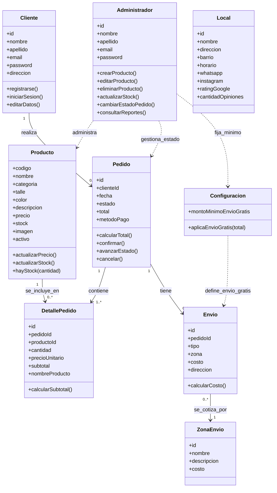

# Diagrama de clases (modelo de dominio)

> Negocio: **Sistema de Gestión de Ventas para OCN Villa Urquiza** (venta de indumentaria urbana de marca propia).
> Basado en `docs/Proyecto de Desarrollo de Sistema.docx` (Análisis de Requerimientos, agosto 2026).
> Los modelos están en `backend/src/models/`: una clase por entidad, solo con atributos.



## Estados de `Pedido`

```text
Pendiente → Confirmado → En preparación → Enviado → Finalizado
Pendiente → Cancelado (estado alternativo, solo desde Pendiente: se restablece el stock)
```

## Reglas de negocio

- RN-01: no se vende si `stock == 0` (ni más unidades que el stock disponible).
- RN-02: `email` único por cliente.
- RN-03: el cliente solo cancela un pedido en estado `Pendiente`.
- RN-04: envío gratuito solo si el total supera `Configuracion.montoMinimoEnvioGratis`, que fija el administrador.
- RN-05: si el administrador cambia el precio de un producto que está en un carrito, se actualiza antes de confirmar la compra.

## Notas de diseño

- `Producto` representa una variante concreta (un talle y un color) con su propio stock, tal como lo define el documento de requerimientos. La web agrupa por nombre las variantes de una misma prenda para elegir talle y color.
- `Producto.activo` permite **desactivar** un producto (pedido del documento: "eliminar o desactivar") sin perder los pedidos que lo incluyen.
- `Envio.tipo` es `retiro_local` o `domicilio`; con retiro no hay zona, costo ni dirección.
- `DetallePedido.nombreProducto` guarda el nombre al momento de la compra, para que el historial no cambie si el producto se edita o se elimina.
- RN-04 se aplica cuando el subtotal **alcanza o supera** el monto mínimo (así el aviso "te faltan $X" llega a cero justo en el mínimo).
- `Pedido.metodoPago` es solo una etiqueta (efectivo, transferencia o Mercado Pago): el pago se hace al retirar o recibir, no hay pasarela.
- `Local`, `ZonaEnvio` y `Configuracion` se agregaron en esta etapa para cubrir los datos del local, el costo por zona y la regla RN-04.

## Métodos

Los métodos del diagrama son una guía: en la Entrega 1 los modelos solo tienen atributos. La lógica vive en la capa de servicios de la Entrega 2 (`backend/src/services/`), por ejemplo `PedidoService.calcularTotal()` y `PedidoService.cancelar()`.
